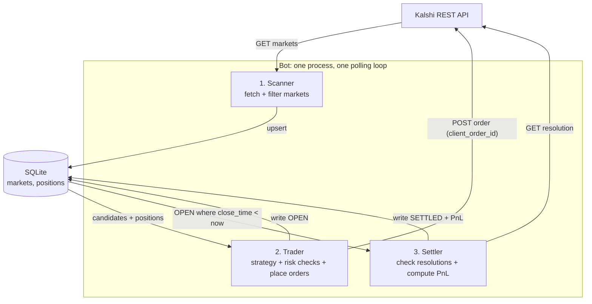

# Prediction Market Trading Bot

A lightweight, human-readable prediction market trading bot for [Kalshi](https://kalshi.com).

---

## Strategy & Trading Model

- **Binary markets only**: Trades standalone binary (`YES` / `NO`) contracts when a market is open.
- **Pluggable direction strategies**: Chooses a side (`YES` or `NO`) using a configurable strategy (e.g., `last_3` trend-following from recent series resolutions, or `random`) and places a **1-contract** order.
- **Hold to expiration**: Never sells early; holds open contracts until market expiration.
- **One bet per market per strategy**: Positions and `client_order_id`s are scoped by environment and strategy so multiple strategies can run side-by-side without duplicate bets.
- **Automated settlement & PnL**: Once `close_time` passes and Kalshi resolves the market, records the final outcome and PnL in SQLite.

---

## Architecture



### Core Components

1. **Ingestion & API Layer (`ingestion/`)**:
   - `ingestion/api/client.py`: Kalshi REST API v2 client with RSA-PSS request signing, market queries, and order submission (supports both `demo.kalshi.co` and production, plus simulation mode).
   - `ingestion/scanner.py` (**Step 1: Scanner**): Polls open markets, filters for standalone binary contracts, and upserts them into SQLite.

2. **Trading & Settlement Layer (`risk_engine/`)**:
   - `risk_engine/engine.py` (**Step 2: Trader**): Evaluates open markets against risk rules and existing positions, selects `YES` or `NO` via the active strategy (`STRATEGIES`), places orders, and records `OPEN` positions.
   - `risk_engine/settler.py` (**Step 3: Settler**): Checks expired `OPEN` positions against Kalshi resolutions, computes PnL in cents, and marks positions `SETTLED`.

3. **Storage Layer (`db.py`)**:
   - Local SQLite state (`markets` and `positions` tables) using `StrEnum`-enforced schemas, WAL mode, and isolation by environment (`demo.kalshi.co` vs `production`) and strategy.

4. **Telemetry Layer (`logging/`) [TODO]**:
   - Reserved for future ClickHouse telemetry and analytics.

---

## Project Layout

```text
trading-bot/
├── ingestion/           # Step 1: Scanner + Kalshi REST API client & auth
├── risk_engine/         # Step 2: Trader (strategies & risk checks) + Step 3: Settler
├── logging/             # Telemetry & analytics layer (TODO)
├── tests/               # Unit and smoke tests (pytest)
├── db.py                # SQLite schema, StrEnums, and state queries
├── main.py              # CLI entry point and main polling loop
├── pyproject.toml       # Project metadata, ruff, and pytest configuration
├── render.yaml          # Render worker deployment config
└── requirements.txt     # Python dependencies
```

---

## Setup & Usage

### 1. Install dependencies

```bash
pip install -r requirements.txt
```

### 2. Configure environment variables

Copy `.env.example` to `.env` and set your Kalshi credentials:

```bash
cp .env.example .env
```

> **Note**: See `.env.example` for all supported variables (demo vs. production keys/URLs and `ENABLE_LIVE_ORDERS`, which defaults to `false` for safe simulation mode).

### 3. Run the bot

```bash
# Run continuously with default settings
python main.py

# Run a single polling cycle and exit
python main.py --once

# Specify strategy, polling interval, or database path
python main.py --strategy last_3 --interval 10 --db trading_bot.db
```

Run `python main.py --help` to see all available CLI options.

---

## Testing

```bash
# Full test suite
pytest -v

# Quick smoke tests
pytest -m smoke
```

---

## TODO / Future Extensions

- **Real-Time Kalshi Order Execution & Kill-Switch Daemon**:
  - **Overview**: Move beyond basic API trading scripts to a low-latency, resilient order manager that runs 24/7 on a headless box. Manages live Kalshi market orders, enforces strict drawdown stop-outs, and hedges positions automatically when event probabilities swing.
  - **State Machine & Finite Execution Engine**: Manage order lifecycles (`PENDING_SUBMIT`, `ACKNOWLEDGED`, `PARTIALLY_FILLED`, `FILLED`, `CANCELED`) using a deterministic state machine to avoid orphan limit orders or ghost fills during network timeouts.
  - **Heartbeat & Fail-Safe Circuit Breaker**: Implement a watchdog process. If the WebSocket stream drops or exchange latency exceeds a tight threshold (e.g., >500ms), trip a circuit breaker that immediately cancels open resting orders and blocks new executions.
  - **In-Memory Order Book State**: Maintain a localized, fast in-memory representation of resting bids/asks fed by a persistent WebSocket delta stream, decoupled from strategy decision threads via bounded channels or worker queues.
