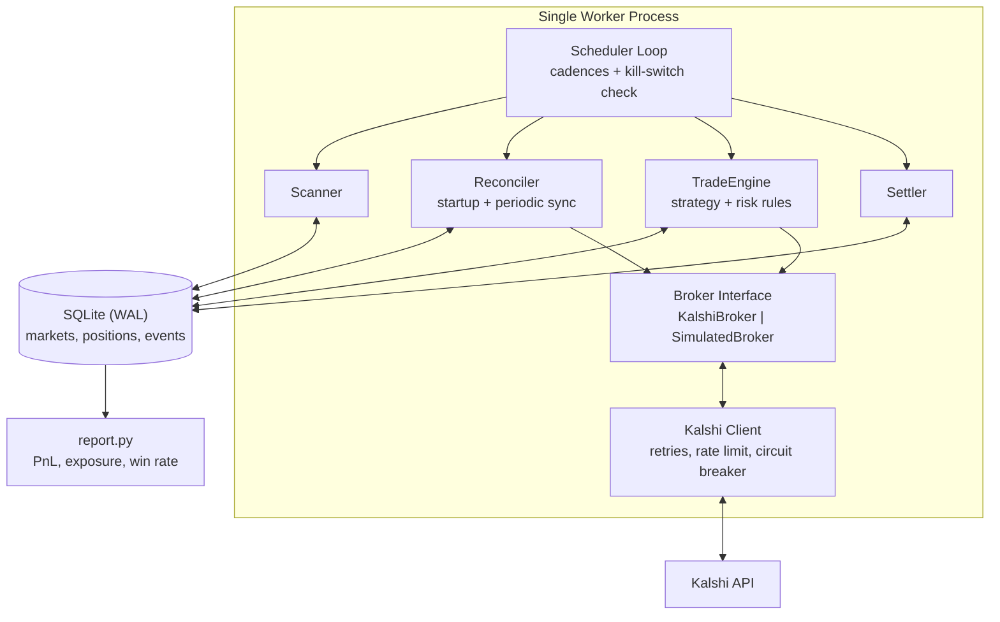
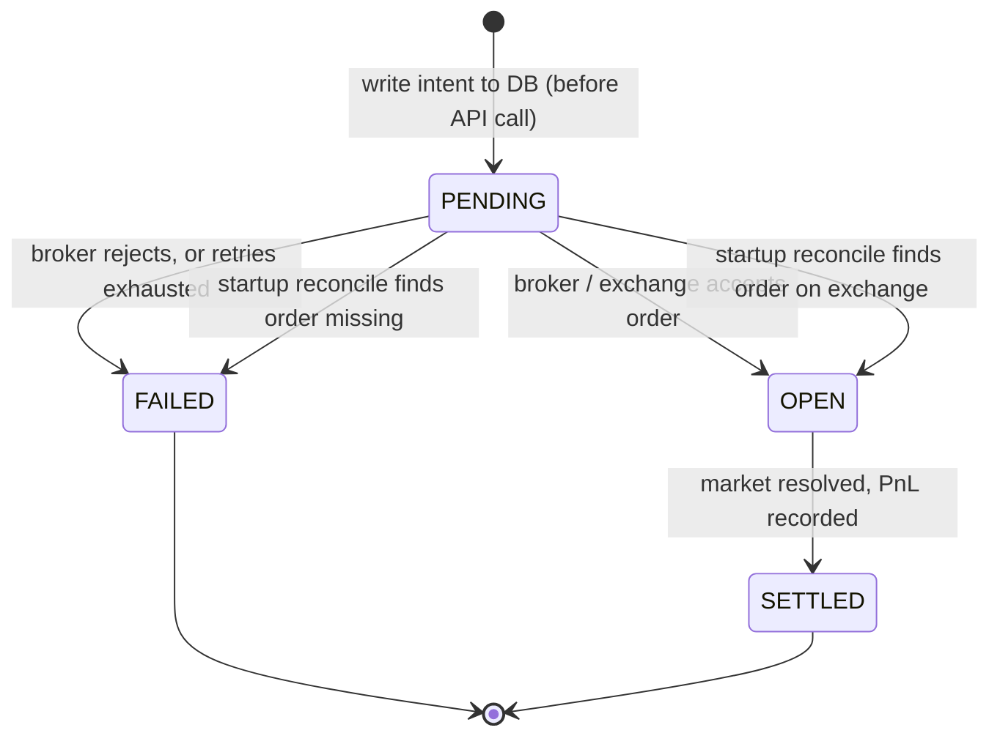

# Prediction Market Trading Bot

A lightweight, robust prediction market trading bot for [Kalshi](https://kalshi.com).

---

## Overview

The bot operates as an idempotent, single-process pipeline designed for reliability and simplicity:

1. **Scanner**: Discovers and filters open binary prediction markets and persists them to the local database.
2. **Trader (TradeEngine)**: Evaluates candidates against composable risk rules and pluggable strategies, writes order intent before execution, and tracks positions through a clean state machine.
3. **Settler**: Queries market resolutions once contracts expire, computes PnL in cents, and settles positions.
4. **Reconciler**: Runs on startup and periodically to reconcile pending and open orders with exchange records, guaranteeing resilience against process crashes and network partitions.

---

## Architecture & Data Flow



### Order State Machine



- **Write-ahead intent**: Orders are recorded as `PENDING` before any network call is dispatched.
- **Deterministic IDs**: `client_order_id` is derived from `(env, strategy, ticker, side)`, making retries idempotent.
- **Database constraints**: Enforces one bet per market per strategy at the database level.

---

## Risk & Resilience Guardrails

- **Safe by Default**: Runs in simulated paper-trading mode unless live trading is explicitly enabled.
- **Risk Rules**: Composable, pure checks evaluated before order placement (market status, expiration time, bankroll position caps, daily loss cap, and local kill switch).
- **Client Resilience**: Outgoing API requests include timeouts, client-side rate limiting, exponential backoff with jitter on transient errors, and a circuit breaker that pauses requests if failures persist.
- **Audit Logging**: All lifecycle events (scans, skips, rejects, fills, and settlements) are recorded in an `events` table in SQLite for auditing and debugging.

---

## Quick Start

### 1. Installation

```bash
pip install -r requirements.txt
```

### 2. Configuration

Copy the example configuration to `.env` and set your Kalshi credentials:

```bash
cp .env.example .env
```

### 3. Running the Bot

```bash
# Run continuously with default settings (demo simulation mode)
python main.py

# Run a single cycle and exit
python main.py --once

# Run with a specific strategy or database file
python main.py --strategy last_9 --db trading_bot.db
```

### 4. Viewing Performance Reports

```bash
python report.py
```

### 5. Running Tests

```bash
pytest
```

---

## Deployment

The bot runs as a single worker process on platforms like Render or any Linux host. When deploying to containerized or cloud environments, attach a persistent volume to mount your SQLite database file (e.g. `/var/data/trading_bot.db`) to ensure state persists across redeploys.
