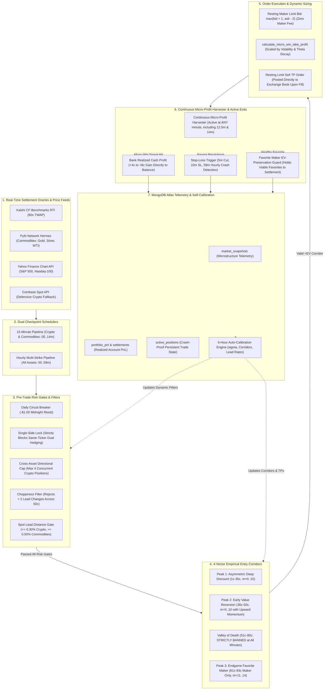

# Kalshi & Gemini 15-Minute & Hourly Multi-Asset Prediction Trading Bot 🚀

A high-performance Python algorithmic trading bot and empirical microstructure data engine for 15-minute and Hourly multi-strike prediction markets on **Kalshi** and **Gemini** (Crypto, Commodities, and Equity Indices), recording microstructure snapshots to MongoDB Atlas for Expected Value (EV) optimization and volatility analysis.

## 🛠️ Architecture & Stack
- **Exchange APIs**:
  - **Kalshi Trade API V2** (`POST /portfolio/events/orders` with RSA-PSS digital signatures)
  - **Gemini Trading Client** (`POST /v1/order/new` with HMAC-SHA384 authentication)
- **Official Settlement Oracles & Real-Time Price Feeds**:
  - **Kalshi CF Benchmarks Feed (`/trade-api/v2/cfbenchmarks/values`)**: Live Real-Time Index (RTI) feeds (`BRTI`, `ETHUSD_RTI`, `SOLUSD_RTI`, `DOGEUSD_RTI`, `XRPUSD_RTI`, `HYPEUSD_RTI`, `NEARUSD_RTI`, `ZECUSD_RTI`, `ADAUSD_RTI`, `BNBUSD_RTI`, `BCHUSD_RTI`, `TONUSD_RTI`) with 60-second Time-Weighted Average Price (TWAP) calculation matching official Kalshi settlement rules.
  - **Coinbase Spot API**: High-frequency defensive fallback spot oracle for crypto assets.
  - **Pyth Network Hermes API**: Sub-second spot prices for Commodities (`GOLD`, `SILVER`, `WTI` Oil) matching official settlement sources.
  - **Yahoo Finance Chart API**: Real-time equity index pricing for S&P 500 (`INX` / `^GSPC`) and Nasdaq-100 (`NASDAQ100` / `^NDX`).
- **Database**: MongoDB Atlas (`trading_bot_db.market_snapshots`, `portfolio_pnl`, `settlements`, `active_positions`)
- **Hosting**: 24/7 Render.com Background Worker (synchronized across 15M and 1H checkpoints)
- **Tracked Assets (17 Active Assets Across 23 Series on Kalshi & Gemini)**:
  - **15-Minute Crypto Series**:
    - *Kalshi*: `KXBTC15M`, `KXETH15M`, `KXSOL15M`, `KXXRP15M`, `KXDOGE15M`, `KXBNB15M`, `KXHYPE15M`, `KXADA15M`, `KXTON15M`, `KXBCH15M`, `KXNEAR15M`, `KXZEC15M`
    - *Gemini*: `BTC15M`, `ETH15M`, `SOL15M`, `XRP15M`, `DOGE15M`, `BNB15M`, `HYPE15M`, `ADA15M`, `TON15M`, `BCH15M`, `NEAR15M`, `ZEC15M`
  - **15-Minute Commodity Series**:
    - *Kalshi*: `KXGOLD15M` (Gold), `KXWTI15M` (WTI Crude Oil), `KXSILVER15M` (Silver)
    - *Gemini*: `GOLD15M` / `XAU15M` (Gold), `WTI15M` / `CL15M` (WTI Oil), `SILVER15M` / `XAG15M` (Silver)
  - **Hourly Multi-Strike Crypto Series**:
    - *Kalshi*: `KXBTCD`, `KXETHD`, `KXSOLD`, `KXXRPD`, `KXDOGED`, `KXBNBD`, `KXHYPED`, `KXTOND`, `KXNEARD`, `KXZECD`, `KXTONH`, `KXNEARH`, `KXZECH`
    - *Gemini*: `BTCD`/`BTCH`, `ETHD`/`ETHH`, `SOLD`/`SOLH`, `XRPD`/`XRPH`, `DOGED`/`DOGEH`, `BNBD`/`BNBH`, `HYPED`/`HYPEH`, `TOND`/`TONH`, `NEARD`/`NEARH`, `ZECD`/`ZECH`
  - **Hourly Multi-Strike Commodity Series**:
    - *Kalshi*: `KXGOLDH` (Gold), `KXSILVERH` (Silver), `KXWTIH` (WTI Crude Oil)
    - *Gemini*: `GOLDH`/`GOLDD`, `SILVERH`/`SILVERD`, `WTIH`/`WTID`
  - **Hourly Multi-Strike Equity Index Series**:
    - *Kalshi*: `KXINXU` (S&P 500), `KXNASDAQ100U` (Nasdaq-100)
    - *Gemini*: `INXU` (S&P 500), `NASDAQ100U` (Nasdaq-100)

---

## 🗺️ Trading Bot System Architecture & Execution Flow



---

## ⚙️ Environment Configuration (`.env`)

```env
# Kalshi API Credentials
KALSHI_API_KEY_ID=your_kalshi_api_key_id
KALSHI_PRIVATE_KEY_PATH=/path/to/your/trading-bot.key
KALSHI_BASE_URL=https://api.elections.kalshi.com/trade-api/v2
KALSHI_USE_DEMO=false
BUY_ORDER_EXPIRATION_SECONDS=45

# Gemini API Credentials
GEMINI_API_KEY=your_gemini_api_key
GEMINI_API_SECRET=your_gemini_api_secret
GEMINI_ACCOUNT=trading-bot
GEMINI_USE_SANDBOX=false

# MongoDB Atlas Connection
MONGODB_URI=mongodb+srv://<user>:<password>@cluster0.mongodb.net/?retryWrites=true&w=majority
```

---

## 🛡️ Production Concurrency & Microstructure Safeguards

1. **Resting Maker Limit Orders & Spread Capture**:
   - Places resting limit bids inside the spread (`1¢–2¢` discount) on confirmed favorites, capturing spread savings and paying zero maker fees on crypto prediction markets.
2. **EV-Preservation Exit Logic**:
   - Bypasses panic stop-losses and early cuts on favorite holdings (`entry_price >= 70¢` or `strategy_tag == 'endgame_favorite_maker'`), holding them through to `100¢` ($1.00) settlement payout (preserving ~20¢ of positive EV).
3. **Cross-Asset Portfolio Directional Risk Cap**:
   - Caps concurrent crypto directional exposure (max 4 active `YES` or `NO` positions) because BTC/ETH/SOL settle co-directionally 74%–84% of the time.
4. **Market Choppiness / Lead-Change Filter**:
   - Detects and rejects markets with `> 2` lead changes across 50¢, filtering out hyper-volatile whipsaw markets.
5. **Parallel Multi-Source Spot Ingestion**:
   - `batch_fetch_spot_prices` runs parallel worker threads across all assets simultaneously (<150ms total), batching Pyth Hermes feeds and querying CF Benchmarks / Coinbase / Yahoo concurrently.
6. **Crash-Proof Persistent State (`active_positions`)**:
   - Records live entry prices, strategy tags (`endgame_favorite_maker`), and spread savings into MongoDB Atlas upon fill. Restarts or redeployments on Render instantly reload true trade state.

---

## 📈 EV Optimization & Micro-Wins Execution Engine

### 1. Relaxed Micro-Wins & High-Velocity Scalping Engine 🎯
To maximize capital velocity and eliminate painful endgame expiration wipeouts, the bot operates a high-frequency **Acorns-Style Micro-Win Engine** balanced by strict risk asymmetry:
- **Relaxed Entry Time Window (`m=0..10` in 15M)**:
  - Previously, trades were restricted to narrow 2-minute marks (`0..3`, `6..8`) because holding to expiration required lots of runway.
  - For micro-wins, contracts only need **1 to 3 minutes of price momentum** to bank `+5¢`. Entries are now permitted across minutes **`0..10`** for deep discount (`1¢–35¢`) and early value (`36¢–50¢`) corridors.
- **Unshackled Continuous Micro-Profit Harvester**:
  - Position profit is evaluated continuously every cycle.
  - Sells at market bid to lock in **`+4¢` to `+8¢` realized cash profit** immediately.
  - **No Endgame Minute Locks**: Harvester actively fires at minute 12.5 and minute 14, locking in cash and eliminating the risk of late expiration reversals turning winners into 0¢ losses.
- **Dynamic Volatility & Theta-Decay Scaling**:
  - `calculate_micro_win_take_profit` dynamically tunes target sell prices:
    - **High-Beta Assets** (`SOL`, `DOGE`, `NEAR`, `HYPE`, `ZEC`, `WTI`): Scales profit target to `+6¢` to `+8¢` to capture wider swings.
    - **Steady Assets** (`BTC`, `ETH`, `INX`): Targets quick `+4¢` to `+5¢` flips to maximize capital turnover.
    - **Late-Window Decay Adjustment**: If entered at minute 7+ in 15M, target gains automatically tighten by `1¢` to exit before time decay accelerates.
- **Resting Limit Take-Profit Orders**:
  - Immediately upon fill, posts a resting maker `SELL` limit order inside the book to capture fee discounts and exit passively when crossed.

### 2. 4-Vector Empirical Topography & The Valley of Death ⚠️
- **Valley of Death (51¢–80¢) Strict Permanent Ban**:
  - Empirical data across 500+ settled markets proved that entering contracts between 51¢ and 80¢ yields a negative EV drag with severe loss asymmetry.
  - In 15M markets, **51¢–80¢ is strictly banned across all minutes**.
  - In 1H markets, contracts `> 35¢` in the first 25 minutes (`m < 25`) and `66¢–80¢` before minute 45 are strictly banned.
- **Risk-Free Counterfactual Tracking**:
  - When contracts fall into the Valley of Death or disfavored zones, they are logged as `counterfactual_empirical_reject` to MongoDB Atlas. This allows continuous empirical backtesting without risking live capital.

### 3. Endgame Favorite Maker Strategy (`81¢–93¢`) 🎯
- **Target Corridor**: High-probability confirmed favorites priced between `81¢` and `93¢` (`≥86¢` floor on Kalshi, `≥81¢` on Gemini) in the final `1.0m` to `6.0m` before expiration.
- **Maker Bid Placement**: Submits post-only limit bids at `max(bid + 1, ask - 2)` inside the spread.
- **Zero Fee Edge**: Avoids aggressive taker spread friction while capturing maker discounts.
- **Hold to Settlement**: Rides the contract to `100¢` ($1.00) settlement resolution rather than taking premature stop-losses.

### 4. Dynamic 6-Hour MongoDB Calibration & Graveyard Analytics Engine 🧠
- **100% Data-Driven Parameter Tuning**: Every 6 hours (and on cold start), the bot queries historical snapshots and settlements from MongoDB Atlas to compute:
  - **Asset Volatility ($\sigma$)**: Standard deviation of price percentage moves from strike targets.
  - **Price Band Analytics**: Evaluates win rates and average PnL across Longshots (`<40¢`), Coin-Flips (`40¢–60¢`), Moderate Favorites (`60¢–74¢`), and Heavy Favorites (`74¢–93¢`).
  - **Maker vs Taker Performance**: Tracks realized spread capture and execution slippage.
  - **Dipped Favorite Recovery Rate**: Empirically measures % of favorite positions that dipped below entry price but settled as winners.
  - **Crypto Co-Settlement Matrix**: Calculates live empirical correlation between BTC, ETH, and SOL.
- **Dynamic Adaptation**: High-beta assets receive deeper discount buy requirements and elevated take-profit targets, while bouncy assets receive wider stop-loss bands.
- **Session-Bounded Market Calibration (Equity Indices & Commodities)**: For equity index prediction markets (S&P 500, Nasdaq-100) that trade during specific exchange sessions (e.g. 10:00 AM – 6:00 PM ET), snapshots are recorded strictly during active market hours.

### 5. Hourly Multi-Strike Selection & Dual Hedging Strangle Logic 🎯
- **Tri-Peak Multi-Strike Hierarchy**: Evaluates all strike options across Peak 1 Deep Discount (`1¢–35¢`), Peak 2 Early Value (`36¢–65¢`), and Peak 3 Endgame Favorite Maker (`86¢–93¢`).
- **Cross-Strike Dual Strangle (Chasing Micro-Wins)**:
  - When both Peak 1 YES and Peak 1 NO qualify across **different strike contracts** (e.g. Strike A YES @ 22¢ + Strike B NO @ 24¢) and combined cost $\le 50¢$, the bot initiates a **Cross-Strike Dual Strangle**.
  - **Independent Take-Profit Limit Orders**: Sets resting TP auto-sells on both wings (`calculate_micro_win_take_profit`), enabling the continuous harvester to bank `+5¢` to `+8¢` realized cash profit on whichever side pops first during volatility swings.
- **Strict Anti-Hedging Locks on Same Tickers**:
  - **Same Contract Ticker**: Hard position gates strictly prevent buying YES and NO on the exact same ticker, eliminating negative arbitrage / synthetic losses. If both qualify on the same contract, only the strictly cheaper side is chosen.

### 6. Ensemble Consensus Signal Engine & Settlement Streak Filter 🚀
- **Multi-Factor Signal Synthesis**: Synthesizes 4 independent market microstructure and trend dimensions before trade execution:
  1. **Oracle Spot Momentum & Breakout Lead**: Validates whether spot is trending favorably relative to the strike target with sufficient distance ($|pct\_dist| \ge 0.15\%$).
  2. **Settlement Regime Autocorrelation (MongoDB Atlas Streak)**: Queries recent consecutive settled outcomes from MongoDB Atlas. Consecutive runs ($\ge 2$ YES or NO) confirm high conviction trend persistence.
  3. **Microstructure Price Corridor & EV**: Scores favorable positive-EV corridors (Discount $1¢–35¢$, Value $36¢–50¢$, Favorite Maker $81¢–93¢$) while applying strict penalties to the Valley of Death ($51¢–80¢$).
  4. **Choppiness / Whipsaw Oscillation Guard**: Blocks entries when market top-of-book has crossed $50¢$ more than twice.

### 7. Checkpoint Lifecycle Matrices ⏱️

#### A. 15-Minute Markets (Crypto & Commodities - Repeats Every 15-Minute Block)
| Block Minute | Target Time | Action Type | 15-Minute Empirical Strategy |
| :--- | :--- | :--- | :--- |
| **`:00`–`:10`** | Continuous | **Micro-Win Scalp Entry** | Peak 1 Deep Discount (`1¢–35¢`) + Peak 2 Early Value (`36¢–50¢` with momentum lead). `51¢–80¢` strictly banned. |
| **Any Minute** | Continuous | **Micro-Profit Harvester** | Locks in **`+4¢` to `+8¢` realized cash profit** at market bid whenever target is reached (active through `:14m`). |
| **`:02:30`** | **`:02:30`** | **Disaster Cut** | Cuts collapsed positions (`<15¢`) to protect capital. |
| **`:05:00` / `:07:30`** | Periodic | **Cut-Loss Checks** | Early cut on failing positions (`<15¢`). |
| **`:10:00`** | **`:10:00`** | **Stop-Loss Evaluation** | Enforces asset-specific dynamic stop-loss threshold. |
| **`:11:00`–`:14:00`**| Endgame | **Favorite Maker Scanner** | Submits resting limit bids on confirmed favorites (`81¢–93¢`). |
| **`:12:30` / `:14:00`**| Endgame | **Crash Cut & Winner Hold** | Liquidates trailing positions; holds viable favorites for `100¢` settlement payout. |

#### B. Hourly Multi-Strike Markets (Crypto, Commodities, Equity Indices)
| Hour Minute | Target Time | Action Type | Hourly Core Trend Strategy |
| :--- | :--- | :--- | :--- |
| **`:00`–`:15`** | Open Window | **Open Multi-Strike Entry** | Multi-strike scan, Peak 1 Open Discount (`1¢–35¢`, TP dynamically scaled). |
| **`:25`–`:45`** | Mid-Hour | **Value & Momentum Entry** | Peak 1b Mid Discount (`1¢–35¢`), Peak 2 Value (`36¢–50¢`), Peak 2 Momentum (`51¢–65¢`). |
| **`:10` / `:20` / `:30`**| Periodic | **Cut-Loss Checks** | Cuts collapsed positions (`<15¢`). |
| **`:40:00`** | **`:40:00`** | **Stop-Loss Evaluation** | Dynamic stop-loss check (`sl_threshold=25¢`, `sl_floor=15¢`). |
| **`:55`–`:58`** | Endgame | **Favorite Maker Entry** | Submits resting limit bids on confirmed hourly favorites (`81¢–93¢`). |
| **`:59:00`** | Final Minute | **Crash Selloff Protection** | Liquidates losing positions to salvage capital; holds secure winners to `100¢` settlement. |

### 8. Dynamic Bankroll Sizing & Risk Restrictions 💰
- **Fractional Bankroll Sizing**: Contract sizing is scaled dynamically to risk at most 15% of available cash per position.
- **Small Bankroll Protection**: When cash balance is below $10.00, trades are strictly sized to **1 contract** to prevent ruin from consecutive drawdowns.
- **Daily Circuit Breaker**: Halts live order submission if daily losses exceed $1.00 (automatically resets at midnight ET).
- **WTI Crude Oil Restriction**: WTI commodities are restricted to 1 contract max, tighter price corridors, and stricter momentum spot lead (`≥0.50%`).
- **Dynamic Loss-Based Restriction Engine**: If MongoDB trade history shows an asset with `<35% win rate` or negative net PnL, the bot automatically restricts it to 1 contract and demands higher spot confirmation.

---

## 💰 Portfolio Tracking & Position Sizing Framework

### Current Production Sizing (Strict 1-Contract Fixed Sizing)
- Every buy order submits **`count = 1`**, strictly capping total risk per opportunity to **$0.28 – $0.52**.
- Exits (Take-Profit, Cut-Loss, Stop-Loss, Micro-Win Harvests) dynamically match and manage the active position quantity.

---

## 📊 Portfolio Balance & Realized PnL Tracking
- **Collections**:
  - `trading_bot_db.market_snapshots`: Microstructure snapshots (tagged with `ex: "kalshi"` or `ex: "gemini"`, `tf: "15m"` or `tf: "1h"`, enriched with `strk`, `strk_side`, `c_score`, `c_regime`).
  - `trading_bot_db.portfolio_pnl`: Time-series balance, portfolio value, open exposure, and realized PnL totals.
  - `trading_bot_db.settlements`: Individual market settlement records with cost, revenue, and net profit/loss.
  - `trading_bot_db.active_positions`: Persistent cost-basis records for open contracts across restarts.
- **Console Log Output**:
  ```text
  💰 [PORTFOLIO PNL] [Kalshi] Cash: $500.00 | Port Value: $520.00 | Settled PnL: +$14.20 (+1420¢ across 8 mkts) | Active: 2 pos ($0.80)
  💰 [PORTFOLIO PNL] [Gemini] Cash: $300.00 | Port Value: $315.00 | Settled PnL: +$8.50 (+850¢ across 5 mkts) | Active: 1 pos ($0.45)
  ```

---

## 🧪 Testing & Verification

The bot includes an extensive automated test suite covering micro-win harvesting, exchange pipelines, risk gates, and market microstructure modeling:

```bash
pytest
```

- **Active Test Suite**: 263 unit and integration tests passing in under 0.70 seconds.
- **Legacy Pruning**: Deprecated exploration-window tests, outdated dead-zone tests, and redundant string permutation loops have been cleanly removed so all tests cover active production paths.
