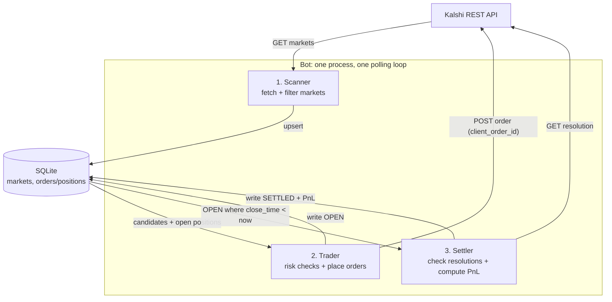

# Prediction Market Trading Bot

A simple, human-readable prediction market trading bot for [Kalshi](https://kalshi.com).

---

## Strategy

The trading strategy is straightforward:
- **If a market is open (and when it opens)**: Randomly place a bet of **1 contract** on one side (**"YES"** or **"NO"**).
- **Never sell**: Hold the contract until expiration and hope for the best!
- **No duplicate bets**: We only bet once per market while it is open.
- **Settle & compute PnL**: Once `close_time` has passed and Kalshi resolves the market (`determined` / `finalized`), record the outcome and PnL in SQLite.

---

## Architecture



### System Design

1. **Ingestion & API Layer (`ingestion/`)**:
   - `ingestion/api/client.py`: Connects to the Kalshi REST API v2, signs requests with RSA-PSS authentication, fetches open markets (`GET /markets`), submits orders (`POST /portfolio/events/orders` with `client_order_id`), and queries market resolutions (`GET /markets/{ticker}`).
   - `ingestion/scanner.py` (**Step 1: Scanner**): Fetches open markets, filters for standalone binary markets, and upserts them into SQLite.

2. **Trading & Settlement Layer (`risk_engine/`)**:
   - `risk_engine/engine.py` (**Step 2: Trader**): Reads candidate markets and existing positions from SQLite, checks risk rules (binary, open, no existing position), randomly bets 1 contract on `YES` or `NO`, and writes `OPEN` positions to SQLite.
   - `risk_engine/settler.py` (**Step 3: Settler**): Queries `OPEN` positions where `close_time < now`, checks Kalshi for market resolution (`result` in `yes`/`no`), computes PnL in cents, and marks the position `SETTLED` in SQLite.

3. **SQLite Storage (`db.py`)**:
   - Lightweight local SQLite database storing `markets` and `positions`.

4. **Logging Layer (`logging/`) [TODO]**:
   - Marked as **TODO** (ClickHouse in the future for fast market telemetry and analytics).

---

## Folder Structure

```text
trading-bot/
├── ingestion/
│   ├── api/                 # Kalshi REST API client & auth
│   │   ├── __init__.py
│   │   └── client.py
│   ├── __init__.py
│   ├── client.py            # Re-exports from ingestion.api.client
│   └── scanner.py           # 1. Scanner: fetch + filter markets -> upsert to DB
├── risk_engine/
│   ├── __init__.py
│   ├── engine.py            # 2. Trader: risk checks + place orders -> write OPEN
│   └── settler.py           # 3. Settler: check resolutions + compute PnL -> write SETTLED
├── logging/                 # Logging layer (TODO for ClickHouse)
│   └── TODO.md
├── tests/                   # Clean unit tests
│   ├── conftest.py
│   ├── test_smoke.py
│   ├── test_ingestion.py
│   ├── test_risk_engine.py
│   └── test_main.py
├── db.py                    # SQLite database helper (markets & positions tables)
├── main.py                  # Bot entry point (one process, one polling loop)
├── render.yaml              # Render worker deployment config
├── requirements.txt         # Python packages
└── README.md                # Documentation
```

---

## Setup & Installation

### 1. Install dependencies

```bash
pip install -r requirements.txt
```

### 2. Configure environment variables

Copy `.env.example` to `.env`:

```bash
cp .env.example .env
```

Set your Kalshi credentials:
```env
KALSHI_API_KEY_ID=your_api_key_id
KALSHI_PRIVATE_KEY_PATH=/path/to/your/kalshi.key
KALSHI_BASE_URL=https://demo-api.kalshi.co/trade-api/v2
ENABLE_LIVE_ORDERS=false
```

> **Note**: `ENABLE_LIVE_ORDERS=false` keeps the bot in safe simulation mode. Set it to `true` to place real orders on Kalshi.

---

## Running the Bot

### Run continuously (loop)
```bash
python main.py
```

### Run once and exit
```bash
python main.py --once
```

---

## Running Tests

Run the full pytest suite:
```bash
pytest -v
```

---

## TODO / Future Extensions

- **Real-Time Kalshi Order Execution & Kill-Switch Daemon**:
  - **Overview**: Move beyond basic API trading scripts to a low-latency, resilient order manager that runs 24/7 on a headless box. Manages live Kalshi market orders, enforces strict drawdown stop-outs, and hedges positions automatically when event probabilities swing.
  - **State Machine & Finite Execution Engine**: Manage order lifecycles (`PENDING_SUBMIT`, `ACKNOWLEDGED`, `PARTIALLY_FILLED`, `FILLED`, `CANCELED`) using a deterministic state machine to avoid orphan limit orders or ghost fills during network timeouts.
  - **Heartbeat & Fail-Safe Circuit Breaker**: Implement a watchdog process. If the WebSocket stream drops or exchange latency exceeds a tight threshold (e.g., >500ms), trip a circuit breaker that immediately cancels open resting orders and blocks new executions.
  - **In-Memory Order Book State**: Maintain a localized, fast in-memory representation of resting bids/asks fed by a persistent WebSocket delta stream, decoupled from strategy decision threads via bounded channels or worker queues.
