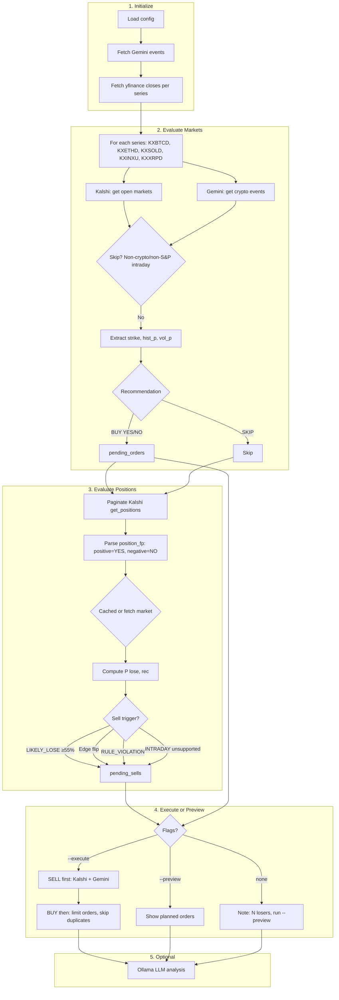

# Kalshi Prediction Market Trading Bot

A bot that connects to the [Kalshi API](https://docs.kalshi.com/) to monitor selected prediction markets and help you decide when to trade.

**What is a prediction market?** Think of it like betting on yes/no questions—e.g. "Will Bitcoin be above $81,250 on March 16?" You buy YES if you think it will happen, or NO if you think it won't. If you're right, you profit (usually $1 per contract); if wrong, you lose what you paid. Prices in cents represent the market's estimated probability—e.g. 40¢ means people think there's about a 40% chance. The bot looks for times when that crowd price is off compared to historical data.

## Setup

1. **Install dependencies** (recommended: use a virtual environment)

   ```bash
   python3 -m venv .venv
   source .venv/bin/activate   # On Windows: .venv\Scripts\activate
   pip install -r requirements.txt
   ```

   If you use system Python and see `ModuleNotFoundError`, create a venv and install there.

2. **Configure credentials**

   Copy `.env.example` to `.env` and fill in your values:

   ```bash
   cp .env.example .env
   ```

   | Variable | Description | Where to get it |
   |----------|-------------|-----------------|
   | `KALSHI_API_KEY_ID` | Your API Key ID (UUID format) | [Account Settings → API Keys](https://kalshi.com/account/profile) |
   | `KALSHI_PRIVATE_KEY_PATH` | Path to your `.key` file **or** | Download when you create an API key |
   | `KALSHI_PRIVATE_KEY` | Raw PEM content (alternative to path) | Same key, as string with `\n` for newlines |
   | `KALSHI_USE_DEMO` | `true` for demo, `false` for production | Demo: [demo.kalshi.com](https://demo.kalshi.com) |

   For **demo**, use `https://demo-api.kalshi.co` and create keys at [demo.kalshi.com](https://demo.kalshi.com/account/profile).

3. **Select markets to watch**

   Edit `config.yaml` or set the `MARKETS` env var:

   ```yaml
   markets:
     - KXBTCD       # Bitcoin daily
     - KXETHD       # Ethereum daily
     - KXSOLD       # Solana
     - KXINXU       # S&P 500
     - KXXRPD       # XRP daily
   ```

   Or: `MARKETS=KXBTCD,KXETHD,KXSOLD,KXINXU,KXXRPD`

Run scripts from the project root (e.g. `python scripts/bot.py`). Scripts add the project root to `sys.path` so imports work correctly.

## Running

```bash
python scripts/bot.py
```

The bot will:
- Connect using your API credentials
- Fetch open markets for each series/ticker you configured
- Log prices (YES/NO bids) and status
- Apply strategy rules when you add them in `config.yaml` / `scripts/bot.py`

## Kalshi API Overview

- **Auth**: RSA-PSS signature with your private key. Required headers: `KALSHI-ACCESS-KEY`, `KALSHI-ACCESS-TIMESTAMP`, `KALSHI-ACCESS-SIGNATURE`.
- **Endpoints**:
  - Public: `/markets`, `/markets/{ticker}`, `/markets/{ticker}/orderbook` (no auth for market data)
  - Authenticated: `/portfolio/balance`, `/portfolio/orders`, `POST /portfolio/orders` for trading
- **URLs**:
  - Production: `https://api.elections.kalshi.com/trade-api/v2`
  - Demo: `https://demo-api.kalshi.co/trade-api/v2`

See [Kalshi API docs](https://docs.kalshi.com/welcome) and [Making your first request](https://docs.kalshi.com/getting_started/making_your_first_request).

## Project structure

```
trading-bot/
├── scripts/                 # Runnable entry points (run from project root)
│   ├── bot.py               # Main polling bot
│   ├── compare_historical.py # Evaluate contracts → BUY YES / NO / SKIP
│   ├── compare_prices.py    # Quick live price snapshot
│   ├── debug_ollama.py      # Debug Ollama LLM integration (run when analysis fails)
│   └── test_connection.py   # Test API connections
├── config.py                # Config loader (yaml + env overrides)
├── config.yaml              # Markets, strategy, trading settings
├── kalshi_client.py         # Kalshi API client
├── gemini_client.py         # Gemini Prediction Markets client
├── yfinance_client.py       # Price data (yfinance + CoinGecko fallback)
├── ollama_analysis.py       # Ollama LLM analysis integration
└── .env                     # Credentials (from .env.example)
```

All scripts in `scripts/` add the project root to the Python path and load `.env` from the project root, so run them from the project directory: `python scripts/compare_historical.py`.

## Improvement roadmap

See [IMPROVEMENTS.md](IMPROVEMENTS.md) for the full roadmap. Implemented: Kelly criterion, whitelist/blacklist, file logging, volatility-based probability (with per-contract resolution time), systematic edges (intra- and inter-exchange arbitrage), XRP support, low-balance limit-order fallback, Ollama LLM analysis (with llama3.2:1b fallback).

## Contract evaluation workflow

**Goal:** Use historical price data to estimate fair probability, then compare to Kalshi/Gemini market prices → recommend **BUY YES** / **BUY NO** / **SKIP**.

**Example in plain English:** Imagine a bet: "Will Bitcoin be above $81,250 on March 16?" The bot looks at the last year of Bitcoin prices and finds that Bitcoin closed above that level only 5% of the time. So the "fair" chance of YES is about 5%. If the market is charging 40¢ for YES (i.e. people think there's a 40% chance), the market is overpricing YES. The bot would recommend **BUY NO** (bet against it) or **SKIP** if the edge isn't big enough.

Run `scripts/compare_historical.py` every **15 minutes** locally for continuous evaluation. See [Cron setup](#run-every-15-minutes) below.

### Key terms in plain English

| Term | Plain-English meaning |
|------|------------------------|
| **BUY YES** | Bet that the event *will* happen (e.g. Bitcoin *will* be above $81,250). You profit if you're right. |
| **BUY NO** | Bet that the event *won't* happen (e.g. Bitcoin *won't* be above $81,250). You profit if you're right. |
| **Edge** | How much we think we're getting a bargain. If we think the real chance is 20% but the market prices it at 10¢ (10%), we have a 10% edge. |
| **Bid** | The highest price someone is willing to *pay* to buy. |
| **Ask** | The lowest price someone is willing to *accept* to sell. (Buying at the ask = paying the seller's price.) |
| **Strike / threshold** | The number the bet is about. E.g. "$81,250" in "Bitcoin above $81,250". |
| **Resolution** | When the bet settles—e.g. "5pm ET" means we use the price at 5pm Eastern that day to determine who wins. |
| **Limit order** | "Buy only if the price is X or better." Your order waits in the book until someone matches it. Safer than "buy at whatever price is available now." |
| **Volatility** | How much prices swing. High volatility = bigger moves up and down; low = calmer. Affects how likely the price is to reach a target. |
| **Arbitrage** | Risk-free profit from a pricing mistake. E.g. if YES costs 40¢ and NO costs 50¢ on the same bet, buying both costs 90¢ but one must win (payout $1), so you lock in 10¢ profit. |
| **Dry run** | Practice mode: the bot figures out what it *would* do but doesn't place any real orders. |
| **Contract** | One market/bet—e.g. "Bitcoin above $81,250 on March 16." Each contract has YES and NO sides. |
| **Position** | A bet you already hold. If you bought 10 YES contracts, you have a "position" of 10 YES. |
| **Payout** | What you get if you win. Usually $1 per contract—so if you paid 30¢ and win, you profit 70¢. |

### Flow diagram: `scripts/compare_historical.py`



**ASCII version** (for terminals / plain-text viewers):

```
┌─────────────────────────────────────────────────────────────────────────────┐
│                         compare_historical.py                                │
└─────────────────────────────────────────────────────────────────────────────┘

  ┌──────────────┐     ┌──────────────┐     ┌──────────────────────────────────┐
  │ Load config  │────▶│ Fetch        │────▶│ For each series (KXBTCD, KXETHD,  │
  │ markets,     │     │ yfinance     │     │ KXSOLD, KXINXU, KXXRPD):         │
  │ yf_tickers   │     │ closes       │     │   • Get Kalshi open markets       │
  └──────────────┘     └──────────────┘     │   • Get Gemini events (crypto)    │
                                            └────────────────┬─────────────────┘
                                                             │
                         ┌───────────────────────────────────┘
                         ▼
  ┌─────────────────────────────────────────────────────────────────────────────┐
  │ For each market (Kalshi + Gemini):                                           │
  │   1. Skip? → Non–crypto/non–S&P intraday only. Crypto/S&P: all intraday OK   │
  │   2. Arb first: intra (yes+no<1) or inter (Kalshi↔Gemini). If found → orders  │
  │   3. Extract strike (e.g. $72,250 above) from market                          │
  │   4. hist_p = empirical P(close above/below strike) from past N days (365)   │
  │   5. vol_p  = volatility model (optional, --use-volatility)                  │
  │   6. Compare hist_p vs market YES price → BUY YES / BUY NO / SKIP            │
  │   7. If not SKIP → add to pending_orders (limit price = bid × (1−dip_pct))    │
  └─────────────────────────────────────────────────────────────────────────────┘
                                                             │
                                                             ▼
  ┌─────────────────────────────────────────────────────────────────────────────┐
  │ Evaluate ALL positions (paginate Kalshi get_positions):                      │
  │   • Parse position_fp (positive=YES, negative=NO) for each position          │
  │   • Cached? Use market_data_cache. Uncached? Fetch market + closes           │
  │   • Sell triggers (when we recommend selling a position you hold):            │
  │       - LIKELY_LOSE:     We now think the bet will probably lose (≥55% chance)│
  │       - Edge flip:       We used to say BUY YES; now we say BUY NO (or vice versa) — cut losses, don't double down
  │       - RULE_VIOLATION:  You hold NO on "price above X" but price already > X — the bet is going against you
  │       - INTRADAY_MARKET: Non–crypto/non–S&P intraday → exit position         │
  │   • Add to pending_sells                                                     │
  └─────────────────────────────────────────────────────────────────────────────┘
                                                             │
           ┌─────────────────────────────────────────────────┼─────────────────┐
           ▼                                                 ▼                 ▼
  ┌──────────────────┐                           ┌──────────────────┐  ┌─────────────┐
  │ --execute         │                           │ --preview         │  │ No flags    │
  │ Place real orders │                           │ Show planned      │  │ Eval only   │
  └────────┬─────────┘                           │ orders (no exec)  │  │ + note if   │
           │                                      └──────────────────┘  │ pending     │
           ▼                                                                      │
  ┌─────────────────────────────────────────────────────────────────────────────┐
  │ EXECUTE order: SELL first → then BUY (so balance reflects sell proceeds)    │
  │   1. SELL: Kalshi + Gemini limit sells at bid                               │
  │   2. BUY:  Kalshi + Gemini limit buys (skip if open order exists)           │
  │            Price = bid × (1 − limit_dip_pct) to catch dips                   │
  └─────────────────────────────────────────────────────────────────────────────┘
                                                             │
                                                             ▼
  ┌─────────────────────────────────────────────────────────────────────────────┐
  │ Optional: Ollama LLM analysis (local) — skip with --no-llm                  │
  └─────────────────────────────────────────────────────────────────────────────┘
```

## Ollama LLM analysis (optional)

When [Ollama](https://ollama.com) is running locally, scripts send their output to a free local LLM for trading opinions.

1. Install [Ollama](https://ollama.com) and pull a model:
   ```bash
   ollama pull llama3.2
   ```
2. Ensure Ollama is running (often auto-starts in the background).
3. Run any script — the last output will be the LLM’s analysis:
   ```bash
   python3 scripts/compare_prices.py
   python3 scripts/compare_historical.py
   python3 scripts/test_connection.py
   ```

To skip LLM analysis (e.g. for cron or automation):
```bash
python3 scripts/compare_historical.py --no-llm
python3 scripts/compare_prices.py --no-llm
python3 scripts/test_connection.py --no-llm
```

Override model via `OLLAMA_MODEL`:
```bash
OLLAMA_MODEL=mistral python3 scripts/compare_historical.py
```

**Troubleshooting: "Ollama skipped: not running or model missing"**

If you see this message at the end of a run, either Ollama isn't running or the model isn't installed:

1. **Start Ollama** — Open the Ollama app (Applications or Spotlight). It must be running before you run the script.
2. **Pull a model** — Run `ollama pull llama3.2` or `ollama pull llama3.2:1b` (smaller, faster). The bot tries `llama3.2` first, then `llama3.2:1b`, then `mistral`, etc.
3. **Verify** — Run `ollama list` (or `curl http://localhost:11434/api/tags`) to confirm models are installed. If `ollama list` crashes (known macOS Metal bug), the server may still work—the Python client uses the HTTP API.
4. **Debug** — Run `python3 scripts/debug_ollama.py` to test the integration and surface any errors.
5. **Override model** — If you only have `llama3.2:1b`: `OLLAMA_MODEL=llama3.2:1b python3 scripts/compare_historical.py`

If Ollama isn't running or the model is missing, scripts still run and finish without the LLM analysis.

## Scripts

Scripts send their output to a local [Ollama](https://ollama.com) model for trading opinions. Install and run Ollama, then pull a model:

```bash
# Install Ollama from https://ollama.com, then:
ollama pull llama3.2
```

When you run `scripts/compare_prices.py`, `scripts/compare_historical.py`, or `scripts/test_connection.py`, the script prints verbose data as usual, then adds an **OLLAMA ANALYSIS** section with the model’s take (e.g. mispriced contracts, risks, suggestions). Uses free local models (`llama3.2`, `mistral`, `phi3`, etc.).

- **Skip LLM** for cron or non-interactive runs: add `--no-llm`
- **Override model**: `OLLAMA_MODEL=qwen2.5:3b python3 scripts/compare_prices.py`

If Ollama isn’t running or the model is missing, scripts still run and finish without analysis.

## Scripts

| Script | Purpose |
|--------|---------|
| `python3 scripts/test_connection.py` | Test Kalshi & Gemini connections |
| `python3 scripts/compare_prices.py` | Quick live snapshot (prices only) |
| **`python3 scripts/compare_historical.py`** | **Evaluate contracts → BUY YES / BUY NO / SKIP** |

### Ollama LLM analysis (local, free)

All three scripts send their raw output to a local [Ollama](https://ollama.com) LLM for a brief analysis: which contracts look mispriced, risks, and suggestions.

1. Install & run Ollama: [ollama.com](https://ollama.com)
2. Pull a model: `ollama pull llama3.2` (or `mistral`, `phi3`, `qwen2.5:3b`)
3. Run any script; the last output is Ollama's opinion

To skip LLM analysis (e.g. for cron): `python3 scripts/compare_historical.py --no-llm`

### Main evaluation: `scripts/compare_historical.py`

**In plain English:** The bot looks at how often the asset (e.g. Bitcoin) closed above or below a target price in the past year. It compares that "historical chance" to what the market is charging. If the market is underpricing (e.g. we think 30% chance, market says 15¢), we **BUY YES**. If overpricing, we **BUY NO**. If there's not enough of a bargain, we **SKIP**.

```bash
python3 scripts/compare_historical.py --days 365 --markets 0 --edge 0.15   # 0 = all markets
python3 scripts/compare_historical.py --preview              # Show planned orders without placing them
python3 scripts/compare_historical.py --execute              # Place real buy/sell orders (one-shot live run)
python3 scripts/compare_historical.py --execute --no-llm    # Live run, skip LLM analysis
python3 scripts/compare_historical.py --use-volatility      # Add option-style probability (log-normal model)
```

**Single production live run** — Evaluate markets and place real orders if the bot finds opportunities:

```bash
python3 scripts/compare_historical.py --execute --no-llm
```

Requires `trading.dry_run: false` in config.yaml.

**Flags**

| Flag | Description |
|------|-------------|
| `--days` | Historical lookback (default: 365, or config `strategy.days_back`) |
| `--markets` | Max markets per series (0 = all, default) |
| `--edge` | Min "bargain size" to recommend buy—how much cheaper than fair we need (default: 15%) |
| `--execute` | Place real Kalshi orders for buys and sells (requires dry_run: false) |
| `--preview` | **Preview mode**: print Kalshi/Gemini API calls we would make, without placing any orders |
| `--use-volatility` | Add volatility-based probability (option-style log-normal model) alongside empirical P |
| `--verbose`, `-v` | Show closes range vs threshold (explains historical P) |
| `--no-llm` | Skip Ollama analysis |
| `--log` | Log run to `~/Desktop/trading-bot-logs/eval_YYYYMMDD.log` (or `--log DIR` for custom dir) |

Config: `strategy.min_edge`, `strategy.days_back`, `strategy.days_to_expiry`, `strategy.limit_dip_pct`, `strategy.intraday_other_min_p_win`, `strategy.use_kelly`, `strategy.min_arb_fee`, `strategy.enable_intra_arb`, `strategy.enable_inter_arb`, etc. in `config.yaml`.

### Intraday markets (5pm, 8pm, etc.)

**In plain English:** Some bets settle at a specific time (e.g. "Bitcoin price at 5pm ET today"). We support 5pm for crypto and 4pm for S&P 500. For other times (e.g. 8pm), we're extra cautious and only suggest buying when we're almost certain (≥90% chance).

The bot evaluates **all** crypto and S&P 500 intraday markets (e.g. "Bitcoin today at 8pm ET"), not only 5pm crypto / 4pm S&P:

| Resolution | Logic |
|------------|-------|
| **5pm ET crypto** / **4pm ET S&P 500** | Standard `min_edge` (e.g. 10%) — same as before |
| **Other intraday** (e.g. 8pm ET) | Strict threshold: only BUY when P(win) ≥ `intraday_other_min_p_win` (default 90%) — "almost certain" |
| **Non–crypto / non–S&P** with intraday | Skipped (no supported time) |

For "Bitcoin today at 8pm ET", we only recommend BUY YES when historical says ≥90% chance price ends above the strike, and BUY NO when ≥90% chance it ends below. Uses daily closes as a proxy (no intraday data yet).

**Config:** `strategy.intraday_other_min_p_win: 0.90` in `config.yaml`.

### Systematic edges (arbitrage, cross-platform hedging)

**In plain English:** Sometimes the market prices YES and NO in a way that guarantees profit if you buy both. For example, if YES costs 40¢ and NO costs 50¢ on the same bet, buying both costs 90¢—but one side always wins (payout $1), so you lock in 10¢. The bot looks for these "free money" situations before making regular bets.

| Edge | Description | When |
|------|-------------|------|
| **Intra-exchange arb** | Buy YES and NO on the same market when `yes_ask + no_ask < 1 - fee` | Same outcome, one platform (Kalshi or Gemini) |
| **Inter-exchange arb** | Buy YES on one platform and NO on the other when total cost &lt; `1 - fee` | Matching Kalshi + Gemini crypto events (same threshold ±1%) |

**Config** (`config.yaml` → `strategy`):

```yaml
min_arb_fee: 0.02      # Min edge for arb (2%): only act when profit >= 2%
enable_intra_arb: true   # Intra-exchange: buy YES+NO when sum < 1
enable_inter_arb: true   # Inter-exchange: Kalshi↔Gemini cross-hedge
```

*In plain English:* `min_arb_fee` is the smallest profit we demand before acting. 0.02 = 2%: we only buy both sides when the guaranteed profit is at least 2¢ per $1 bet (after fees).

The bot checks for arb *before* making normal BUY YES/NO suggestions. If it finds one, it places both sides of the bet and skips the directional recommendation.

### Limit orders & dip catching (Kalshi + Gemini)

**In plain English:** Instead of "buy at whatever price is available now," we say "buy only if the price hits X or better." Your order waits until someone matches it. We also place slightly *below* the current price so that if the market dips briefly, we might get a better deal.

Both platforms place **limit orders** (good-til-cancel) so orders rest on the book until filled. To catch dips when the market temporarily drops:

- **`limit_dip_pct`** (default `0.05`): Place buy limits this much *below* the current bid. E.g. `0.05` = 5% below bid — if bid is 40¢, we place at 38¢. Set to `0` to use the bid directly.
- **Duplicate prevention**: The bot skips placing a new buy if you already have an open limit order for that market and side.

### Probability model

**In plain English:** We estimate the chance of YES two ways: (1) **Empirical** = "In the last year, how often did the price end above (or below) the target?" and (2) **Volatility** = Using how much the price typically swings, we calculate the odds. We use the higher of the two when both are available.

- **Empirical**: fraction of past days the close was above/below the threshold.
- **Volatility** (with `--use-volatility`): log-normal model using historical annualized vol and time-to-expiry. Time-to-expiry is parsed per contract from the title (e.g. "tomorrow at 5pm ET", "March 16 at 5pm") and converted to UTC; falls back to `strategy.days_to_expiry` when parsing fails. Used as `max(empirical, volatility_probability)` for more robust recommendations.

### Quick snapshot: `compare_prices.py`

Live prices only. For BUY/NO/SKIP recommendations, run `scripts/compare_historical.py`:

```bash
python3 scripts/compare_prices.py
```

### Run every 15 minutes

Run the evaluation locally every 15 minutes for continuous monitoring:

```bash
# crontab -e
# Add this line (adjust path to your project and venv):
*/15 * * * * cd /path/to/trading-bot && .venv/bin/python scripts/compare_historical.py --days 365 --no-llm >> eval.log 2>&1
```

Or use a simple loop (for testing):

```bash
while true; do .venv/bin/python scripts/compare_historical.py; sleep 900; done
```

**Note:** `scripts/compare_prices` and `scripts/compare_historical` do not place orders—they only recommend. `scripts/bot.py` can place orders when `trading.dry_run` is `false` (see below).

### Balance-aware order execution (Kalshi)

**In plain English:** The bot never spends more than a set percentage of your account on a single order (e.g. 20%). If an order fails (e.g. insufficient funds), it logs a warning and continues—it doesn't stop the whole run. When balance is very low (below a threshold), instead of skipping the buy entirely, it places a small limit order at a price you can afford—hoping to get filled if the market dips.

Orders placed via `create_order_safe` are capped to your available balance and never cause the script to crash on 4xx (e.g. insufficient funds).

- **Balance cap:** Each order uses at most `max_pct_of_balance` (configurable in `config.yaml`, e.g. 20%) of your Kalshi balance.
- **Low-balance limit fallback:** When balance is below `min_balance_for_limit_fallback_cents` (e.g. 500 = $5) and you can't afford the target order, the bot places a 1-contract limit at a price you can afford (e.g. 60¢ if you have $3 and use 20% per order). Set to `0` to disable.
- **4xx resilience:** If the API returns 4xx (insufficient funds, invalid market, etc.), the script logs a warning and continues.
- **Config** (`config.yaml` → `trading`):

  ```yaml
  trading:
    dry_run: true              # false = place real orders (scripts/bot.py)
    max_pct_of_balance: 0.20   # use at most 20% of balance per order (configurable)
    min_contracts: 1           # skip if capped count < this
    min_balance_for_limit_fallback_cents: 500  # when balance < this, place 1-contract limit instead of skipping; 0 = disabled
  ```

Enable execution in `scripts/bot.py` by setting `buy_yes_below` / `buy_no_below` in `strategy` and `dry_run: false`. Add funds manually as needed.

### Troubleshooting: 400 Bad Request on orders

If you see `HTTPError: 400 Client Error: Bad Request` when placing orders:

- **Price format**: The script sends prices in the format Kalshi expects (4 decimal places, e.g. `0.4500`). If you've customised price formatting elsewhere, ensure it matches.
- **Market closed**: The market may be paused or closed; Kalshi rejects orders for markets that are no longer tradeable.
- **Insufficient balance/position**: `create_order_safe` caps orders by balance (buys) or position size (sells). If the API still returns 400, check your Kalshi balance and positions.
- **Order size**: Ensure `count` is at least 1 and within exchange limits.
- **Error details**: Check the log output—when an order is rejected, the script prints the API error body (e.g. `order rejected (4xx) 400 TICKER - {"error": "..."}`). Use that message to diagnose the cause.
- **Resilience**: Order failures are handled so one bad order does not stop the run. Failed orders are logged; the script continues with the next order.

### Configuring tickers

Add `yfinance_tickers` in `config.yaml` to map Kalshi series to Yahoo Finance tickers:

```yaml
yfinance_tickers:
  KXBTCD: "BTC-USD"   # Bitcoin
  KXETHD: "ETH-USD"   # Ethereum
  KXSOLD: "SOL-USD"   # Solana
  KXINXU: "^GSPC"     # S&P 500
  KXXRPD: "XRP-USD"   # XRP (Ripple)
```

Tickers: `BTC-USD`, `ETH-USD`, `^GSPC`, `SPY`, etc. See [yfinance](https://github.com/ranaroussi/yfinance).

### Gemini Prediction Markets (crypto only)

The comparison scripts also fetch [Gemini Prediction Markets](https://docs.gemini.com/prediction-markets/markets) for **crypto only** (BTC, ETH, SOL, XRP). S&P 500 is not included. The events API is public; no API key required for listing. Optional env vars:

- `GEMINI_USE_SANDBOX=true` - use sandbox API
- `GEMINI_PREDICTION_BASE_URL` - override base URL

**Relevant markets (Gemini Exchange UI):**

| Asset | Type | URL |
|-------|------|-----|
| Bitcoin | Daily | [BTC price on March 16](https://exchange.gemini.com/predictions/BTC2603162100/btc-price-on-march-16?categoryPath=crypto%2Cdaily&status=active) |
| Ether | Daily | [ETH price on March 16](https://exchange.gemini.com/predictions/ETH2603162100/eth-price-on-march-16?categoryPath=crypto%2Cdaily&status=active) |
| Solana | Weekly (no daily) | [SOL price on March 20](https://exchange.gemini.com/predictions/SOL2603202100/sol-price-on-march-20?categoryPath=crypto%2Ccrypto_solana&status=active) |
| XRP (Ripple) | Daily | [XRP price](https://exchange.gemini.com/predictions?categoryPath=crypto&status=active) (if listed) |

**Note:** With `GEMINI_API_KEY` and `GEMINI_API_SECRET` set, `scripts/compare_historical.py --execute` places limit orders on both Kalshi and Gemini. Use `--preview` to see planned orders without placing them.

### References & strategy foundations

The evaluation logic draws on econometric and financial time-series literature:

| Source | Relevance |
|--------|-----------|
| [Taylor (2005)](https://www.lancaster.ac.uk/staff/afasjt/apdvp_contents.pdf) *Asset Price Dynamics, Volatility, and Prediction* | Volatility forecasting works better than directional; GARCH/implied vol improve P(above/below) |
| [Campbell, Lo, MacKinlay (1997)](https://www.nrc.gov/docs/ml1208/ML12088A329.pdf) *The Econometrics of Financial Markets* | Event-study methodology; market model reduces variance of abnormal returns |
| [Tsay](https://cpb-us-w2.wpmucdn.com/blog.nus.edu.sg/dist/0/6796/files/2017/03/analysis-of-financial-time-series-copy-2ffgm3v.pdf) *Analysis of Financial Time Series* | GARCH, ARIMA, structural breaks for volatility and regime modeling |

See [IMPROVEMENTS.md](IMPROVEMENTS.md) for prioritized enhancements (GARCH, implied vol, market-model adjustment, etc.).
